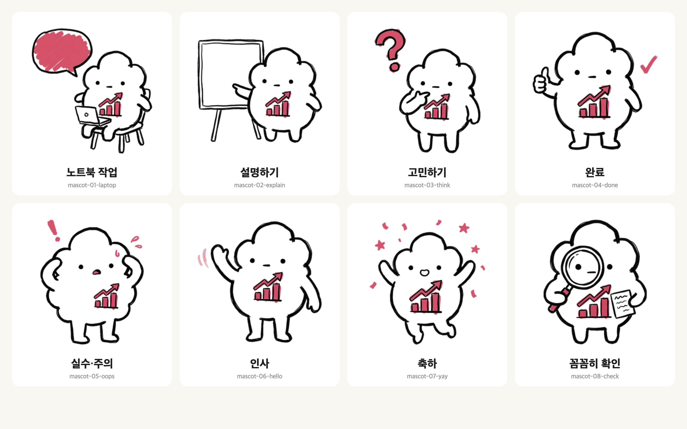

# DataPopcorn Mascot Doodle

데이터팝콘 캐릭터 두들 에셋 세트입니다. 웹 교안과 PPT에 바로 넣을 수 있게 배경을 투명하게 만들었습니다.



## Poses

| File | 포즈 | 쓰기 좋은 곳 |
|---|---|---|
| `mascot-01-laptop.png` | 노트북 작업 | 실습 시작, 따라 하기 화면 |
| `mascot-02-explain.png` | 설명하기 | 개념 설명 |
| `mascot-03-think.png` | 고민하기 | 질문·도입부 |
| `mascot-04-done.png` | 완료 | 단계 완료·정답 |
| `mascot-05-oops.png` | 실수·주의 | 자주 하는 실수·주의사항 |
| `mascot-06-hello.png` | 인사 | 표지·시작과 끝 |
| `mascot-07-yay.png` | 축하 | 성공·결과 공개 |
| `mascot-08-check.png` | 꼼꼼히 확인 | 결과 검증 |

## Files
- `mascot-0N-*.png`: 배경 투명, 여백을 그림에 맞게 자른 버전 (웹 교안용).
- `square/mascot-0N-*.png`: 1000×1000 투명 정사각형, 같은 크기로 가운데 정렬 (PPT에 여러 개를 나란히 놓을 때).
- `contact-sheet.png`: 전체 미리보기.
- `manifest.json`: 포즈·경로·크기 목록.

## Style
- 굵은 붓펜 선, 마커로 칠한 핑크, 통통한 팝콘 몸통, 점 눈과 작은 입.
- 색: 검정 `#161414`, 흰색 `#FFFFFF`, 브랜드 핑크 `#E8506E`만 사용.
- 그림 안에 글자·로고 없음. 말풍선과 화이트보드는 비어 있어 문구를 직접 넣을 수 있음.

## Use in HTML
```html

```

## Notes
- 데이터팝콘 공식 마스코트(`A1-popcorn-kernel`)를 기준으로 Google Gemini에서 생성한 뒤, 배경 제거와 크롭을 따로 처리했습니다 (2026-11-16).
- 데이터팝콘 자체 콘텐츠용 에셋입니다.
